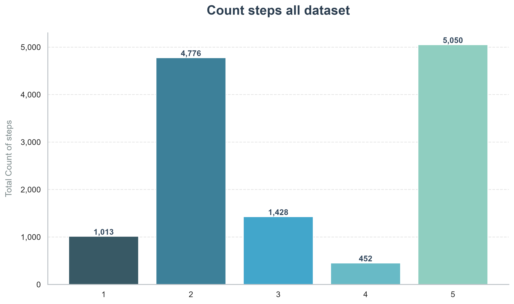
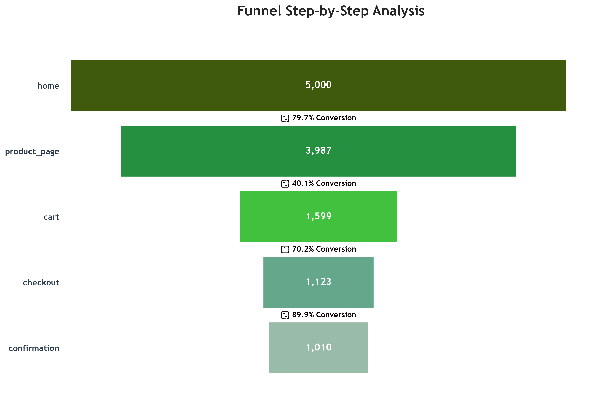

<!-- # Funnel-Drop
Test some datasets funnel drop -->

# Funnel Drop Analysis

**Python | Pandas | Matplotlib | Seaborn | SciPy**

Finding where users drop off in an online store — and what it is actually costing the business.

<!---->

# Executive Summary

This analysis reviewed the customer journey across funnel stages, conversion behavior, and key audience segments to understand where users drop off and whether certain groups show meaningful differences in purchase conversion.

## Seven Key Insights

### 1. The funnel is strongest in the final stages
Approximately 39.70% of all sessions contain only five steps, and the final stage shows a particularly strong conversion pattern. Once users reach the checkout stage, they have a 91.78% probability of continuing to confirmation. This indicates that the business is performing well at the end of the funnel, where motivated users are most likely to complete the purchase.

### 2. The funnel follows a strict, sequential path
No user session skipped any steps in the expected funnel order. This suggests a highly structured journey, and it may also indicate that the dataset was generated or curated in a way that enforces a logical sequence. While the data is useful for testing funnel logic, it does not reflect the irregular flow that is common in real-world customer behavior. 

### 3. The biggest drop-off happens before the cart is completed
The largest decline occurs between the product page and the cart, with a 59.89% reduction in sessions. This is the most important point of friction in the funnel and the clearest place to focus optimization efforts. If users fail to add or commit to items at this stage, the conversion path becomes much weaker downstream.

### 4. Cart size does not meaningfully explain conversion differences
Users with 1 or 3 items in their carts show the highest conversion rates, but the differences across cart sizes are not statistically significant. In practical terms, cart size does not appear to have a strong causal relationship with purchase conversion. That means businesses should be careful not to overinterpret cart-size patterns without further evidence.

### 5. Device type does not create a statistically meaningful conversion gap
When comparing conversion contribution by device, the observed differences are not statistically significant. In other words, purchase behavior is not meaningfully different across device groups in this dataset. This suggests that device-specific optimization should not be assumed to be the primary lever for conversion improvement.

### 6. Country is not a significant driver of purchase conversion
The analysis of conversion by country shows no statistically significant difference in purchase behavior across locations. Although some countries may show slightly different funnel patterns, the variation is not strong enough to conclude that country alone explains conversion differences.

### 7. Referral source does not create a material conversion difference
As with device and country, there is no statistically significant difference in purchase conversion across referral sources. This suggests that acquisition source is not the main factor driving purchase outcomes in this dataset, and that conversion performance is more likely shaped by the user experience within the funnel itself.

## Conclusion
The strongest takeaway from this analysis is that the primary business opportunity lies in reducing drop-off at the product-to-cart transition. The funnel is well-structured and conversion is strong at the final stages, but the largest leakage occurs before users complete their cart journey. Across the dimensions examined — cart size, device, country, and referral source — no segment shows a statistically significant difference in purchase conversion. This means the optimization strategy should focus on universal funnel improvements, especially checkout and cart UX, rather than on segment-specific assumptions. In short, the strongest path to improvement is to remove friction in the purchase flow rather than chase small differences between audiences.

---

## Project Overview

This project analyzes customer journeys and conversion behavior using Python, Pandas, Matplotlib, Seaborn, and SciPy. The notebook explores session-level funnel performance, step-level drop-off, and statistical comparisons across key segments.

## Repository Contents

- `Funnel_drop_analysis.ipynb` — main exploratory analysis notebook
- `customer_journey.csv` — raw customer journey dataset
- `marketing_funnel_data.csv` — additional funnel data used for analysis
- `README.md` — project summary and key findings

## Tech Stack

- Python
- Pandas
- Matplotlib
- Seaborn
- SciPy
- Jupyter Notebook

